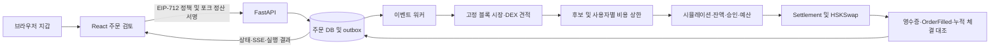

# 시스템 아키텍처

시장 조회와 서명 권한을 분리한다. Trade의 메인넷 공급자는 고정 블록의 토큰 단위와 풀을 확인하고 조회 후 블록 해시를 재확인한다. 오류는 UNVERIFIED로 표시한다. 보관·합성 데이터를 조회 실패 시 실시간 값으로 대체하는 경로는 없다.

주문 본문·서명은 Agent B에 저장하고 공개 주문장에는 서명을 내보내지 않는다. 정책 digest가 주문 추적 ID다. 후보·계획·작업 저널·영수증의 orderId, executionId, planId와 settlementDigest로 API에서 계약 로그까지 추적한다. 여러 사용자의 주문에는 각각의 digest가 존재한다. SSE는 이벤트 ID로 재연결하며 같은 ID를 한 번만 표시한다. 단일 correlation ID가 모든 RPC 호출에 전파되는지는 미검증이다.

MOCK에서는 모의 원장 결과에 실제 해시가 없다. FORK에서는 C 계약의 실제 포크 영수증, 정산 이벤트 및 누적 체결량을 조회한 뒤 확정 상태로 바뀐다. 제출 중에는 PENDING_CONFIRMATION으로 남는다. 기본 개발 DB는 SQLite, Compose에서는 PostgreSQL과 Alembic이다. 워커는 API 애플리케이션 생명주기에서 구동된다.

HSKSwap 풀 수수료와 가격 충격은 견적에 포함한다. A의 경제성 보고서는 같은 초기 상태에서 두 주문을 순차적으로 DEX에 넣는 순서도 바꿔 본다. 계약 내부의 각 사용자 단독 견적, 시장 전체의 순차 반사실, 사용자별 비용 상한을 각각 기록한다. 고정 시연 비용, 선택적 서비스 요금, 미측정 실제 운영비를 합쳐 실현 이익으로 발표할 수 없다.
